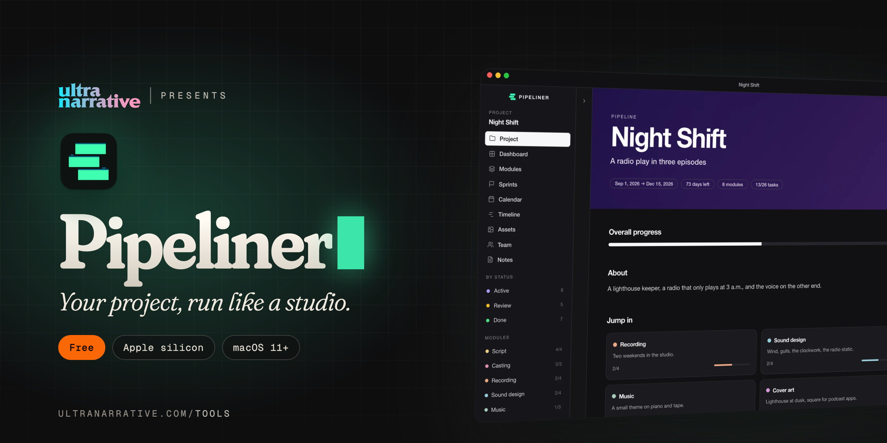

  

# Pipeliner

**Your project, run like a studio.**

*Dan Rodriguez · [UltraNarrative](https://www.ultranarrative.com) · [ultranarrative.com/tools](https://www.ultranarrative.com/tools) · [dan@ultranarrative.com](mailto:dan@ultranarrative.com) · October 2026*

---

Plan a creative project from first sketch to launch: modules, tasks, sprints, a timeline, a calendar, assets and the people on it.

Free, for a Mac with Apple silicon, macOS 11 or later. This repository holds the installer only. More free apps at [ultranarrative.com/tools](https://www.ultranarrative.com/tools).

## Download

[Pipeliner-mac-arm64.dmg](https://github.com/ultranarrative/pipeliner-releases/releases/latest/download/Pipeliner-mac-arm64.dmg)

This link always points to the newest version.

## Opening it the first time

I sign Pipeliner myself rather than through Apple, so macOS asks once. Open the disk image, drag Pipeliner to Applications and open it. When macOS stops it, go to System Settings, then Privacy & Security, and click Open Anyway.

## Support

Pipeliner is free, with no account and no subscription. If it helps you, [buy me a coffee](https://ko-fi.com/danrsuarez).

Made by Dan Rodriguez at [UltraNarrative](https://ultranarrative.com). © 2026 UltraNarrative. All rights reserved.
